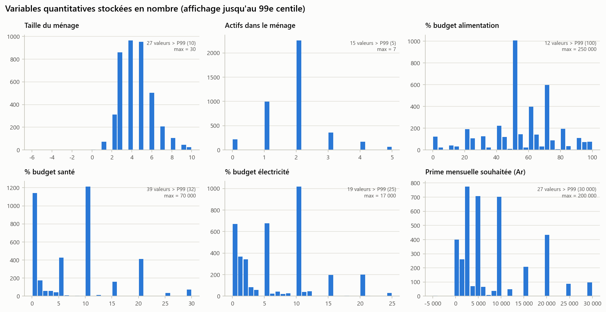
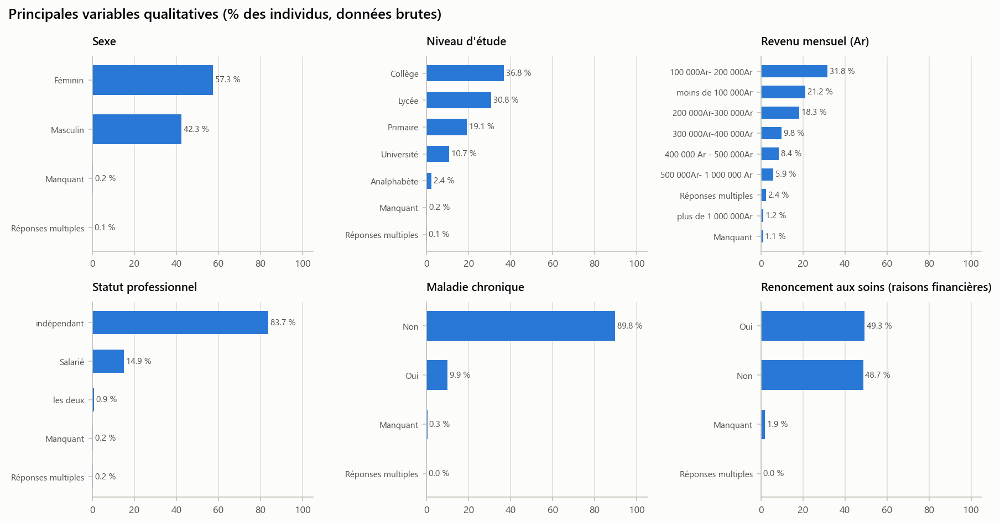
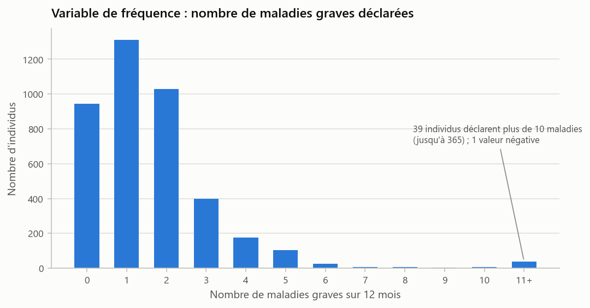
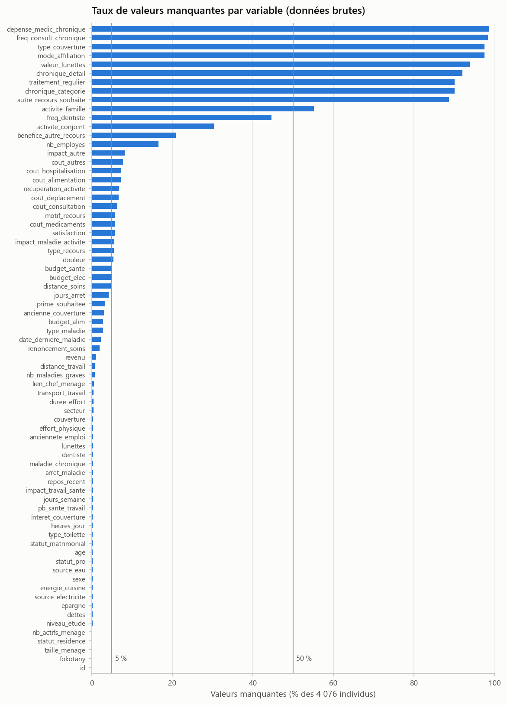

# Étape 1.0 — Présentation des données

> **Énoncé (partie 1)** : présenter les variables disponibles et préciser leur nature ; identifier les variables cibles de la segmentation et des analyses de fréquence et de gravité ; réaliser une analyse descriptive ; présenter un tableau récapitulatif de la base.

## Exécution

```powershell
.venv\Scripts\python.exe partie1_donnees\1.0_presentation\etape_1_0_presentation.py
```

**Notebook** (déjà exécuté : tableaux et figures visibles sans rien relancer) : [`etape_1_0_presentation.ipynb`](etape_1_0_presentation.ipynb). **Version LaTeX** de ce document : `README.tex`.

| Entrée | Sorties |
|---|---|
| `sources/InsuranceData.xlsx` (feuille `DataUsed`) | `resultats/tables/*.csv`, `resultats/figures/*.png`, `resultats/journal.txt` |

Les données ne sont pas modifiées à cette étape. On décrit le fichier **tel qu'il a été saisi**.

---

## 1. Tableau récapitulatif de la base

| Caractéristique | Valeur |
|---|---|
| Observations (individus enquêtés) | **4 076** |
| Variables | **73** |
| dont identifiant | 1 (`id`) |
| dont quantitatives | 22 |
| dont qualitatives | 47 (30 nominales, 17 ordinales) |
| dont texte libre | 3 |
| Variables stockées en nombre dans Excel | 9 |
| Variables quantitatives **saisies en texte** | 14 |
| Cellules manquantes | 15,7 % du total |
| Variables avec plus de 50 % de manquants | 10 |
| Variables sans aucun manquant | 1 (`id`) |
| Lignes en double (hors identifiant) | 2 |
| Identifiant unique | oui |

L'énoncé annonce 4 077 individus : l'écart d'une unité correspond à la ligne d'en-tête du fichier Excel.

## 2. Les variables et leur nature

Les intitulés d'origine, longs et bilingues (français / malgache), ont été remplacés par des **codes courts** (dictionnaire complet ci-dessous et dans `resultats/tables/dictionnaire_variables.csv`).

| Bloc thématique | Nb | Variables |
|---|---|---|
| Identifiant | 1 | id |
| Démographie | 6 | sexe, age, fokotany, lien_chef_menage, statut_matrimonial, niveau_etude |
| Activité professionnelle | 9 | statut_pro, secteur, activite_famille, anciennete_emploi, distance_travail, transport_travail, heures_jour, jours_semaine, nb_employes |
| Ménage et logement | 8 | taille_menage, nb_actifs_menage, activite_conjoint, statut_residence, source_eau, source_electricite, energie_cuisine, type_toilette |
| Revenus et budget | 6 | revenu, budget_alim, budget_sante, budget_elec, epargne, dettes |
| Conditions de travail | 6 | effort_physique, duree_effort, pb_sante_travail, arret_maladie, impact_travail_sante, repos_recent |
| Couverture maladie | 6 | couverture, mode_affiliation, type_couverture, ancienne_couverture, interet_couverture, prime_souhaitee |
| État de santé | 12 | maladie_chronique, chronique_categorie, chronique_detail, traitement_regulier, freq_consult_chronique, depense_medic_chronique, lunettes, valeur_lunettes, dentiste, freq_dentiste, **nb_maladies_graves**, renoncement_soins |
| Dernier épisode de maladie | 10 | date_derniere_maladie, type_maladie, douleur, jours_arret, type_recours, motif_recours, distance_soins, satisfaction, autre_recours_souhaite, benefice_autre_recours |
| Coûts du dernier épisode | 6 | **cout_consultation, cout_hospitalisation, cout_medicaments, cout_deplacement, cout_alimentation, cout_autres** |
| Impact sur l'activité | 3 | impact_autre, impact_maladie_activite, recuperation_activite |

**Nature des variables :**

- **Quantitatives continues** (17) : âge, parts de budget, prime souhaitée, six coûts, deux distances, ancienneté, heures de travail, durée d'arrêt, dépense en médicaments.
- **Quantitatives discrètes** (5) : taille du ménage, nombre d'actifs, jours travaillés par semaine, nombre d'employés, **nombre de maladies graves**.
- **Qualitatives nominales** (30) : sexe, statut, secteur, logement, recours aux soins, réponses oui / non…
- **Qualitatives ordinales** (17) : niveau d'étude, tranche de revenu, échelles de fréquence ou d'intensité (effort physique, problèmes de santé, douleur, satisfaction…).
- **Texte libre** (3) : date et type de la dernière maladie, détail des maladies chroniques.

<details>
<summary><b>Dictionnaire complet des 73 variables</b> (cliquer pour déplier)</summary>

| code | libellé d'origine (tronqué) | bloc | nature | stockage Excel | valeurs distinctes | % manquants |
|:--|:--|:--|:--|:--|--:|--:|
| id | N | Identifiant | Identifiant | nombre | 4076 | 0.0 |
| sexe | Sexe | Démographie | Qualitative nominale | texte | 4 | 0.2 |
| age | Age | Démographie | Quantitative continue | nombre | 53 | 0.2 |
| fokotany | Fokotany | Démographie | Qualitative nominale | texte | 237 | 0.1 |
| lien_chef_menage | Statut familiale | Démographie | Qualitative nominale | texte | 8 | 0.5 |
| statut_pro | statut du professionnel | Activité professionnelle | Qualitative nominale | texte | 6 | 0.2 |
| statut_matrimonial | Statut personnel | Démographie | Qualitative nominale | texte | 5 | 0.3 |
| taille_menage | Effectif du ménage | Ménage et logement | Quantitative discrète | nombre | 18 | 0.1 |
| nb_actifs_menage | Nombre de personne qui travaille | Ménage et logement | Quantitative discrète | nombre | 8 | 0.1 |
| secteur | Votre secteur d'activité | Activité professionnelle | Qualitative nominale | texte | 103 | 0.4 |
| activite_conjoint | Activité du conjoint | Ménage et logement | Qualitative nominale | texte | 17 | 30.3 |
| niveau_etude | Niveau d'étude | Démographie | Qualitative ordinale | texte | 8 | 0.2 |
| statut_residence | Statut Résidence | Ménage et logement | Qualitative nominale | texte | 2 | 0.1 |
| source_eau | Type fournisseur eau | Ménage et logement | Qualitative nominale | texte | 9 | 0.2 |
| source_electricite | Type fournisseur Electricité | Ménage et logement | Qualitative nominale | texte | 21 | 0.2 |
| energie_cuisine | Energie Cuisine | Ménage et logement | Qualitative nominale | texte | 15 | 0.2 |
| type_toilette | Type de toilette | Ménage et logement | Qualitative nominale | texte | 5 | 0.3 |
| activite_famille | Principal activité de la famille | Activité professionnelle | Qualitative nominale | texte | 59 | 55.2 |
| anciennete_emploi | Ancienneté emploi | Activité professionnelle | Quantitative continue | texte (nombres saisis en texte) | 451 | 0.4 |
| distance_travail | Distance travail | Activité professionnelle | Quantitative continue | texte (nombres saisis en texte) | 475 | 0.7 |
| transport_travail | Transport travail | Activité professionnelle | Qualitative nominale | texte | 26 | 0.5 |
| heures_jour | Heures travaillées quotidiennes | Activité professionnelle | Quantitative continue | texte (nombres saisis en texte) | 216 | 0.3 |
| jours_semaine | Nombre de jours travaillés par semaine | Activité professionnelle | Quantitative discrète | texte (nombres saisis en texte) | 128 | 0.3 |
| nb_employes | Votre Nombre employés | Activité professionnelle | Quantitative discrète | texte (nombres saisis en texte) | 95 | 16.6 |
| revenu | Votre Revenu mensuel | Revenus et budget | Qualitative ordinale | texte | 24 | 1.1 |
| budget_alim | % Budget alimentation | Revenus et budget | Quantitative continue | nombre | 97 | 2.8 |
| budget_sante | % Budget santé | Revenus et budget | Quantitative continue | nombre | 35 | 5.1 |
| budget_elec | % Budget électricité | Revenus et budget | Quantitative continue | nombre | 33 | 5.0 |
| epargne | Avoir de l'épargne | Revenus et budget | Qualitative nominale | texte | 2 | 0.2 |
| dettes | Avoir des Dettes impayées | Revenus et budget | Qualitative nominale | texte | 2 | 0.2 |
| effort_physique | Effort physique au travail | Conditions de travail | Qualitative ordinale | texte | 6 | 0.4 |
| duree_effort | Durée de l'effort | Conditions de travail | Qualitative ordinale | texte | 4 | 0.4 |
| pb_sante_travail | Problèmes de Santé au travail | Conditions de travail | Qualitative ordinale | texte | 7 | 0.3 |
| arret_maladie | Arrêt maladie lieu au travail | Conditions de travail | Qualitative ordinale | texte | 5 | 0.3 |
| impact_travail_sante | Impact du travail sur votre santé | Conditions de travail | Qualitative ordinale | texte | 4 | 0.3 |
| repos_recent | Repos travail récemment | Conditions de travail | Qualitative ordinale | texte | 3 | 0.3 |
| couverture | Affiliation Couverture maladie | Couverture maladie | Qualitative nominale | texte | 2 | 0.4 |
| mode_affiliation | Mode affiliation | Couverture maladie | Qualitative nominale | texte | 7 | 97.5 |
| type_couverture | Type couverture | Couverture maladie | Qualitative nominale | texte | 13 | 97.5 |
| ancienne_couverture | Ancienne couverture | Couverture maladie | Qualitative nominale | texte | 2 | 3.0 |
| interet_couverture | Avantage adhérer à une couverture | Couverture maladie | Qualitative ordinale | texte | 7 | 0.3 |
| prime_souhaitee | Votre avis du Prime mensuelle | Couverture maladie | Quantitative continue | nombre | 51 | 3.4 |
| maladie_chronique | Souffrez-vous de Maladies chroniques | État de santé | Qualitative nominale | texte | 3 | 0.3 |
| chronique_categorie | Quelles, maladies chroniques | État de santé | Qualitative nominale | texte | 13 | 90.1 |
| chronique_detail | type maladies chroniques | État de santé | Texte libre | texte | 171 | 92.1 |
| traitement_regulier | Traitement médical régulier | État de santé | Qualitative ordinale | texte | 3 | 90.1 |
| freq_consult_chronique | Fréquence consultation cette maladie | État de santé | Qualitative ordinale | texte | 4 | 98.4 |
| depense_medic_chronique | Depense médicaments | État de santé | Quantitative continue | texte (nombres saisis en texte) | 30 | 98.7 |
| lunettes | Portez-vous des lunettes ? | État de santé | Qualitative nominale | texte | 2 | 0.3 |
| valeur_lunettes | valeur approximative de vos lunettes | État de santé | Qualitative ordinale | texte | 4 | 93.9 |
| dentiste | Consultation d'un dentiste | État de santé | Qualitative ordinale | texte | 3 | 0.3 |
| freq_dentiste | Frequence moyenne par an ? | État de santé | Qualitative ordinale | texte | 4 | 44.6 |
| nb_maladies_graves | Nombre de Maladies graves 12 mois | État de santé | Quantitative discrète | nombre | 28 | 0.7 |
| renoncement_soins | Au cours des 12 derniers mois, avez-vous été malade sans consulter… | État de santé | Qualitative nominale | texte | 4 | 1.9 |
| date_derniere_maladie | Quand avez-vous été dernièrement malade ? | Dernier épisode de maladie | Texte libre | texte | 590 | 2.2 |
| type_maladie | Quel type de maladie avez-vous eue ? | Dernier épisode de maladie | Texte libre | texte | 859 | 2.8 |
| douleur | E.3. Degré de perception de la douleur | Dernier épisode de maladie | Qualitative ordinale | texte | 5 | 5.4 |
| jours_arret | Durée totale de cessation d'activité (jours) | Dernier épisode de maladie | Quantitative continue | texte (nombres saisis en texte) | 280 | 4.1 |
| type_recours | Type de recours | Dernier épisode de maladie | Qualitative nominale | texte | 47 | 5.4 |
| motif_recours | F.3. Pourquoi avez-vous choisi ce type de recours ? | Dernier épisode de maladie | Qualitative nominale | texte | 259 | 5.8 |
| distance_soins | Distance du lieu de consultation | Dernier épisode de maladie | Quantitative continue | texte (nombres saisis en texte) | 261 | 4.7 |
| satisfaction | F.4. Êtes-vous satisfait du traitement ? | Dernier épisode de maladie | Qualitative ordinale | texte | 5 | 5.7 |
| autre_recours_souhaite | F.5. Quelles autres dispositions auraient été plus appropriées ? | Dernier épisode de maladie | Qualitative nominale | texte | 42 | 88.7 |
| benefice_autre_recours | F.6. Ces dispositions auraient donné | Dernier épisode de maladie | Qualitative nominale | texte | 134 | 20.9 |
| cout_consultation | G.1. Frais de consultation | Coûts du dernier épisode | Quantitative continue | texte (nombres saisis en texte) | 92 | 6.3 |
| cout_hospitalisation | G.2. Frais d'hospitalisation | Coûts du dernier épisode | Quantitative continue | texte (nombres saisis en texte) | 51 | 7.3 |
| cout_medicaments | G.3. Coûts des médicaments | Coûts du dernier épisode | Quantitative continue | texte (nombres saisis en texte) | 332 | 5.8 |
| cout_deplacement | G.4. Coût lié au déplacement | Coûts du dernier épisode | Quantitative continue | texte (nombres saisis en texte) | 62 | 6.6 |
| cout_alimentation | G.5. Alimentation supplémentaire | Coûts du dernier épisode | Quantitative continue | texte (nombres saisis en texte) | 109 | 7.2 |
| cout_autres | G.6. Autres à préciser | Coûts du dernier épisode | Quantitative continue | texte (nombres saisis en texte) | 57 | 7.8 |
| impact_autre | H.3. Autre impact de la maladie sur l'activité | Impact sur l'activité | Qualitative nominale | texte | 11 | 8.2 |
| impact_maladie_activite | H.4. Impact ressenti de la maladie sur l'activité | Impact sur l'activité | Qualitative ordinale | texte | 4 | 5.6 |
| recuperation_activite | H.5. Récupération des activités perdues | Impact sur l'activité | Qualitative nominale | texte | 14 | 6.8 |

</details>

## 3. Variables cibles

| Analyse | Variable cible | Rôle | Observations |
|---|---|---|---|
| **Segmentation** (K-means, étape 2.1) | aucune : apprentissage non supervisé | Les assurés sont regroupés selon leur profil (démographie, situation socio-économique, conditions de travail, état de santé). Le **segment obtenu devient la variable cible de l'arbre CART** (étape 2.2). | 4 076 |
| **Fréquence** (GLM, étape 3.1) | `nb_maladies_graves` | *N_i* : nombre de maladies graves déclarées sur les 12 derniers mois (variable de comptage). | 4 047 renseignées |
| **Sévérité** (GLM, étape 3.2) | `cout_total` = somme des six coûts G.1 à G.6 | *S_i* : coût (en Ariary) du dernier épisode de maladie, à la charge de l'assuré. Construit à l'étape 1.1 après conversion du texte libre. | 3 871 individus avec au moins un coût renseigné |

Deux précisions de modélisation :

- **Exposition** : tous les individus sont observés sur la même période (12 mois). L'exposition vaut donc 1 pour tous et le modèle de fréquence n'a pas besoin de terme d'exposition (*offset*).
- **Sinistre** : un sinistre est une maladie grave. Le coût disponible est celui du *dernier* épisode de maladie ; on l'utilise comme estimation du coût d'un sinistre. Le modèle de sévérité sera donc ajusté sur les individus ayant au moins un sinistre (*N_i* ≥ 1) et un coût positif.

## 4. Analyse descriptive des données brutes

### 4.1 Variables quantitatives stockées en nombre

| Variable | n | Moyenne | Écart-type | Min | Q1 | Médiane | Q3 | P99 | Max | Asymétrie |
|---|--:|--:|--:|--:|--:|--:|--:|--:|--:|--:|
| age | 4 066 | 37,8 | 11,5 | **3** | 28 | 37 | 46 | 59 | **112** | 0,3 |
| taille_menage | 4 071 | 4,5 | 1,9 | **−6** | 3 | 4 | 5 | 10 | **30** | 2,8 |
| nb_actifs_menage | 4 070 | 1,9 | 0,9 | 0 | 1 | 2 | 2 | 5 | 7 | 0,9 |
| budget_alim (%) | 3 963 | 264,1 | 5 670 | 0 | 45 | 50 | 70 | 100 | **250 000** | 35,2 |
| budget_sante (%) | 3 870 | 71,1 | 1 559 | 0 | 0 | 10 | 10 | 31,5 | **70 000** | 34,3 |
| budget_elec (%) | 3 873 | 27,2 | 481 | 0 | 1 | 5 | 10 | 25 | **17 000** | 27,0 |
| prime_souhaitee (Ar) | 3 938 | 8 310 | 8 893 | **−5 000** | 2 000 | 5 000 | 10 000 | 30 000 | 200 000 | 4,2 |
| nb_maladies_graves | 4 047 | 2,25 | 13,8 | **−1** | 1 | 1 | 2 | 10 | **365** | 24,2 |

Les quartiles sont cohérents, mais les extrêmes (en gras) révèlent des **erreurs de saisie** : âge de 3 ou 112 ans, ménage de −6 personnes, parts de budget supérieures à 100 % (des montants en Ariary saisis à la place d'un pourcentage), 365 maladies graves par an. Les moyennes et écarts-types bruts ne sont donc pas interprétables : elles seront traitées aux étapes 1.1 (valeurs impossibles) et 1.2 (valeurs aberrantes).



### 4.2 Variables quantitatives saisies en texte

14 variables numériques ont été saisies en texte libre. Elles mélangent nombres, unités et phrases en malgache.

| Variable | Renseignées | Nombres « purs » | Exemples de saisies non numériques |
|---|--:|--:|---|
| anciennete_emploi | 4 061 | 73,5 % | `2ans`, `5ans`, `4taona` (taona = an) |
| distance_travail | 4 046 | 53,8 % | `1km`, `O`, `200m`, `Miovaova` (variable) |
| heures_jour | 4 065 | 81,3 % | `8h`, `Arakaraka` (ça dépend), `4 ~ 5` |
| jours_semaine | 4 064 | 80,9 % | `6j`, `6/7`, `7/7` |
| nb_employes | 3 401 | 79,9 % | `O`, `Tsy mampiasa` (n'emploie personne) |
| jours_arret | 3 907 | 72,8 % | `Herinandro` (une semaine), `Niasa hiany` (a continué à travailler) |
| distance_soins | 3 884 | 66,9 % | `O`, `1km`, `9000 mètre` |
| cout_consultation … cout_autres | ≈ 3 800 chacune | 82 à 94 % | `O` (zéro), `Tsy nisy` (rien), `20 000`, `8000×2:16000`, `Tambavy` (tisane) |

Leur conversion en nombres est réalisée à l'étape 1.1.

### 4.3 Variables qualitatives



- **Profil** : 57 % de femmes ; 53 % de chefs de ménage ; 70 % de personnes mariées ; un niveau d'étude surtout collège (37 %) et lycée (31 %).
- **Activité** : 84 % d'indépendants, principalement dans l'agriculture et le commerce ; 80 % se rendent au travail à pied.
- **Revenus** : 53 % gagnent moins de 200 000 Ar par mois ; seuls 26 % ont une épargne et 14 % ont des dettes impayées.
- **Conditions de travail** : 52 % font « toujours » un effort physique ; 43 % ont « parfois » et 37 % « régulièrement » des problèmes de santé au travail.
- **Couverture maladie** : 97 % **ne sont pas couverts**. C'est une variable quasi constante, donc peu exploitable pour la modélisation.
- **Santé** : 10 % ont une maladie chronique ; **49 % ont renoncé à des soins pour raisons financières** au cours des 12 derniers mois.

**Réponses multiples** : plusieurs modalités sont parfois concaténées dans une même cellule (par exemple « Masculin Féminin », ou deux tranches de revenu). Le cas est rare pour les variables socio-démographiques (1 à 97 cellules), plus fréquent pour le secteur (355), l'électricité (193) et l'énergie de cuisine (190). Il est systématique pour les questions à choix multiples (`motif_recours` : 1 588). Le détail figure dans `resume_qualitatives.csv`.

### 4.4 Variable de fréquence

| Sinistres | 0 | 1 | 2 | 3 | 4 | 5 | 6 | 7–10 | > 10 | négatif | manquant |
|---|--:|--:|--:|--:|--:|--:|--:|--:|--:|--:|--:|
| Individus | 943 | 1 311 | 1 030 | 399 | 177 | 103 | 24 | 20 | 39 | 1 | 29 |



La distribution a la forme attendue d'une variable de comptage (mode à 1, décroissance rapide). Le rapport variance / moyenne brut vaut **84,5**, mais il est dû à une quarantaine de valeurs extrêmes (jusqu'à 365) : la surdispersion sera réévaluée après traitement des valeurs aberrantes (étape 1.2), puis testée à l'étape 3.1 (choix entre Poisson et binomiale négative).

### 4.5 Valeurs manquantes



Trois groupes se dégagent :

1. **Plus de 85 % de manquants (9 variables)** : les questions conditionnelles posées seulement à une petite partie des répondants (détail des maladies chroniques, type de couverture, valeur des lunettes, F.5…).
2. **Entre 15 et 55 %** : `activite_famille` (55 %), `freq_dentiste` (45 %), `activite_conjoint` (30 %), `benefice_autre_recours` (21 %), `nb_employes` (17 %).
3. **Moins de 10 %** : toutes les autres variables. Les coûts et le bloc « dernier épisode de maladie » ont 4 à 8 % de manquants, surtout chez les personnes qui n'ont pas été malades.

## 5. Constats pour l'étape suivante

1. **Identifiant** : `id` est unique et séquentiel ; il sert de clé mais ne sera jamais une variable explicative.
2. **Typage** : 14 variables numériques doivent être converties depuis le texte libre (français / malgache).
3. **Réponses multiples** : à résoudre pour une vingtaine de variables qualitatives.
4. **Valeurs impossibles** (âge, ménage, budgets, prime, fréquence négative) et **valeurs extrêmes** (fréquence jusqu'à 365, coûts) : à traiter aux étapes 1.1 et 1.2.
5. **Variables quasi vides ou quasi constantes** : à exclure en justifiant chaque décision.

→ Suite : [étape 1.1 — Qualité des données](../1.1_qualite/README.md)

## Fichiers produits

| Fichier | Contenu |
|---|---|
| `resultats/tables/dictionnaire_variables.csv` | 73 variables : code, intitulé d'origine, bloc, nature, stockage, modalités, % manquants, exemples |
| `resultats/tables/tableau_recapitulatif.csv` | Tableau récapitulatif de la base |
| `resultats/tables/variables_cibles.csv` | Variables cibles et rôle |
| `resultats/tables/variables_par_nature.csv`, `variables_par_bloc.csv` | Répartition des variables |
| `resultats/tables/stats_quantitatives.csv` | Statistiques descriptives des variables numériques |
| `resultats/tables/quantitatives_saisies_en_texte.csv` | Variables numériques saisies en texte |
| `resultats/tables/frequences_qualitatives.csv` | Effectifs de toutes les modalités brutes |
| `resultats/tables/resume_qualitatives.csv` | Synthèse par variable qualitative (modalités, réponses multiples, modalité principale) |
| `resultats/tables/distribution_nb_maladies_graves.csv` | Distribution de la variable de fréquence |
| `resultats/figures/*.png` | 5 figures |
| `resultats/journal.txt` | Sortie complète du script |
