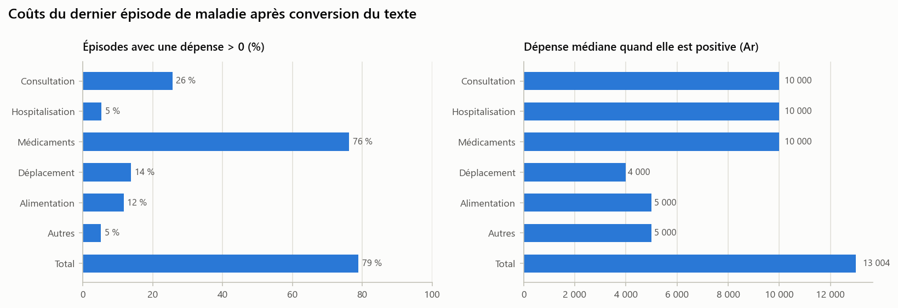
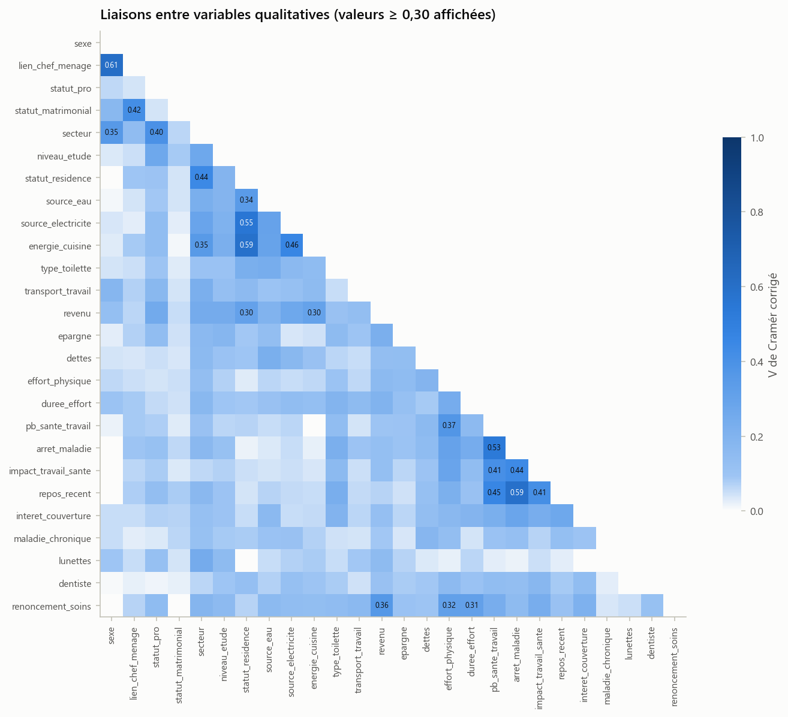

# Étape 1.1 — Analyse de la qualité des données

> **Énoncé (1.1)** : évaluer la qualité des données et identifier les variables non pertinentes (identifiants, variables redondantes ou de variabilité insuffisante) ; analyser les valeurs manquantes et proposer une stratégie (suppression, imputation, modalité spécifique) ; vérifier la cohérence (doublons, valeurs incohérentes, plages de valeurs, variables constantes) et justifier les décisions.

## Exécution

```powershell
.venv\Scripts\python.exe partie1_donnees\1.1_qualite\etape_1_1_qualite.py
```

**Notebook** (déjà exécuté : tableaux et figures visibles sans rien relancer) : [`etape_1_1_qualite.ipynb`](etape_1_1_qualite.ipynb). **Version LaTeX** de ce document : `README.tex`.

| Entrée | Sortie principale |
|---|---|
| `sources/InsuranceData.xlsx` | **`resultats/donnees_qualite.csv`** (et `.xlsx`) : 4 074 individus × 59 colonnes, nettoyé et typé |

Les règles de conversion du texte libre sont dans `commun/outils.py` (fonctions `texte_vers_*`).

---

## 1. Identifiants et variables techniques

| Variable | Constat | Décision |
|---|---|---|
| `id` (colonne « N ») | 4 076 valeurs distinctes, de 1 à 4 076, sans trou : c'est le numéro d'ordre de saisie | **Conservé comme clé** pour suivre chaque individu d'une étape à l'autre, **exclu de tous les modèles** : il ne porte aucune information sur le risque, et un modèle pourrait s'en servir à tort pour capter l'ordre de saisie (enquêteur, quartier…). |

Le fichier ne contient pas d'autre variable technique (date de saisie, code enquêteur…).

## 2. Mise au format (préalable aux contrôles)

### 2.1 Réponses multiples

Dans 24 variables, une même cellule contient parfois plusieurs modalités (par exemple « Masculin Féminin »). **Règle : on garde la première modalité citée**, supposée être la réponse principale. Au total, **1 305 cellules** ont été résolues ainsi.

| Variable | Cellules multiples | % |
|---|--:|--:|
| secteur | 355 | 8,7 |
| type_recours | 222 | 5,4 |
| source_electricite | 193 | 4,7 |
| energie_cuisine | 190 | 4,7 |
| revenu | 97 | 2,4 |
| transport_travail | 88 | 2,2 |
| activite_conjoint | 37 | 0,9 |
| 17 autres variables | 1 à 32 | < 0,8 |

### 2.2 Recodage des modalités

Les 35 variables qualitatives ont été recodées en libellés courts en français. Les numéros de modalité et les traductions malgaches sont supprimés : *Eny* → Oui, *Tsia* → Non, *Tompon-trano* → Propriétaire, *Manofa trano* → Locataire, *Hazo kitay* → Bois, *Tongotra* → À pied… Les tranches de revenu deviennent `<100k`, `100-200k`, …, `>1M` (Ariary par mois). La table de correspondance complète figure dans `tables/recodage_modalites.csv`.

### 2.3 Conversion du texte libre en nombres

| Variable | Nombre pur | Zéro codé (`O`, `00`, `P`) | Phrase = « rien » | Nombre extrait d'une phrase | Fourchette | Calcul | Inexploitable → manquant |
|---|--:|--:|--:|--:|--:|--:|--:|
| anciennete_emploi | 2 986 | 1 | 0 | 968 | 7 | 14 | 85 |
| distance_travail | 1 667 | 672 | 77 | 1 199 | 181 | 0 | 250 |
| heures_jour | 3 305 | 0 | 4 | 586 | 64 | 0 | 106 |
| jours_semaine | 3 287 | 2 | 4 | 709 | 12 | 0 | 50 |
| jours_arret | 2 368 | 528 | 172 | 814 | 8 | 5 | 12 |
| distance_soins | 1 460 | 1 479 | 16 | 896 | 19 | 0 | 14 |
| cout_consultation | 945 | 2 826 | 6 | 30 | 1 | 2 | 8 |
| cout_hospitalisation | 195 | 3 569 | 7 | 6 | 0 | 0 | 1 |
| cout_medicaments | 2 845 | 861 | 46 | 69 | 4 | 3 (+ 2 corrigés à la main) | 11 |
| cout_deplacement | 511 | 3 271 | 7 | 13 | 0 | 2 | 2 |
| cout_alimentation | 412 | 3 236 | 35 | 16 | 2 | 2 (+ 1) | 78 |
| cout_autres | 171 | 3 558 | 5 | 17 | 0 | 5 (+ 1) | 3 |

**Principales règles appliquées** (détail dans les fonctions `texte_vers_*` de `commun/outils.py`) :

- **Montants** : `20 000` → 20000 ; `30000ar` → 30000 ; `8000×2:16000` → 16000 (résultat du calcul) ; `11000 ~ 15000` → 13000 (milieu de la fourchette) ; `15000 (…) + 3000` → 18000 ; `2 million` → 2 000 000. Sinon, on retient le plus grand nombre cité, car les petits nombres sont des quantités ou des durées (`10000 (2000 isanandro)` → 10000).
- **Saisies signifiant « aucune dépense » → 0** : `Tsy nisy` (rien), `Tambavy` / `Evoka` / `Ravina` (tisane, inhalation, feuilles : remèdes traditionnels gratuits), `Nadeha tongotra` (à pied), `Tsa niova ny sakafo` (alimentation inchangée), `Nahazo prise en charge` (pris en charge par un tiers).
- **Inexploitable → manquant** : `Tsy tadidy` (je ne me souviens pas), `Tena volabe no lany` (« beaucoup d'argent »), `Miovaova` / `Arakaraka` (« variable », « ça dépend »).
- **Distances** : `1km` → 1 ; `500 m` → 0,5 ; `0-3km` → 1,5 ; un nombre sans unité ≥ 50 est lu en mètres ; travail à domicile → 0 ; une durée en minutes (`5mn`) → manquant.
- **Durées d'arrêt (jours)** : `Herinandro` (une semaine) → 7 ; `Tapabolana` (quinze jours) → 15 ; `Ray volana` (un mois) → 30 ; `1 mois + 15 jours` → 45 ; `Niasa ihany` (a continué à travailler) → 0.
- **Ancienneté (années)** : `4taona` → 4 ; `6 mois` → 0,5 ; `Depuis 2007` → 19 (année d'enquête 2026) ; `Depuis l'enfance` → manquant.

Limite : un montant donné « par jour » sans durée (`5000 par jours`) est gardé tel quel, ce qui sous-estime le coût. Une dizaine de cas sont concernés.

### 2.4 Construction du coût total (variable de sévérité)

`cout_total` = somme des six postes G.1 à G.6. Un poste vide à côté de postes renseignés compte pour 0 (aucune dépense déclarée) ; si les six postes sont vides, le coût total est manquant.

| Poste | Renseigné | Dépense > 0 | Médiane si > 0 (Ar) | Moyenne si > 0 (Ar) | Maximum (Ar) |
|---|--:|--:|--:|--:|--:|
| Consultation | 3 810 | 26 % | 10 000 | 14 610 | 500 000 |
| Hospitalisation | 3 777 | 5 % | 10 000 | 67 289 | 7 000 000 |
| Médicaments | 3 830 | **76 %** | 10 000 | 26 450 | 1 600 000 |
| Déplacement | 3 804 | 14 % | 4 000 | 11 009 | 450 000 |
| Alimentation | 3 704 | 12 % | 5 000 | 14 185 | 300 000 |
| Autres | 3 757 | 5 % | 5 000 | 45 258 | 2 400 000 |
| **Total** | **3 869** | **79 %** | **13 004** | **41 191** | **9 500 000** |



Les **médicaments** forment l'essentiel de la dépense, ce qui est cohérent avec la place de l'automédication (31 % des recours). L'hospitalisation est rare (5 %) mais coûteuse en moyenne : elle produit la queue de distribution traitée à l'étape 1.2.

### 2.5 Autres harmonisations

- **Fokotany** : 237 écritures brutes → **159 quartiers** après suppression des espaces, de la casse et des variantes d'orthographe (`Andrefatsena` → `Andrefantsena`, `Ampivarotanomby` → `Ampivarotan'omby`…).
- **`declare_non_malade`** : indicateur construit à partir du texte libre `type_maladie` (`Tsy narary` = « je n'ai pas été malade », `0`, `Tsy misy`). Il concerne 262 individus et sert aux contrôles de cohérence et au traitement des manquants du bloc « dernier épisode ».

## 3. Cohérence des données

### 3.1 Doublons

Trois lignes sont **strictement identiques** sur les 72 variables hors identifiant (ids 3460, 3624 et 3898). Ce sont des saisies répétées du même questionnaire. On garde la première (3460) et on **supprime 3624 et 3898**. Il reste **4 074 individus**.

### 3.2 Valeurs hors plage (impossibles) → mises à manquant, puis imputées (§ 4)

| Variable | Règle | Valeurs | Exemples |
|---|---|--:|---|
| age | hors de 15–100 ans (enquête auprès d'actifs) | 4 | 3, 5, 107, 112 |
| taille_menage | moins d'une personne | 5 | −6, 0 |
| nb_actifs_menage | plus d'actifs que de membres du ménage | 12 | 2 à 7 |
| budget_alim / sante / elec | part > 100 % (montant en Ariary saisi à la place d'un %) | 12 / 11 / 9 | 5 000, 20 000, 70 000 |
| prime_souhaitee | négative | 3 | −5 000 |
| prime_souhaitee | entre 1 et 99 Ar (unité ambiguë : milliers d'Ariary ?) | 18 | 1, 5, 10, 40 |
| nb_maladies_graves | négatif | 1 | −1 |
| heures_jour | > 24 h ou 0 h | 9 | 0, 406 |
| jours_semaine | > 7 jours ou 0 jour | 13 | 0, 8, 13, 67 |
| anciennete_emploi | supérieure à (âge − 5) ans | 14 | 20 ans pour un âge de 22 ans |
| jours_arret | plus d'un an pour un épisode | 2 | 730, 3 650 |

Ces valeurs sont **impossibles** ; elles sont donc mises à manquant plutôt que plafonnées. Les valeurs **possibles mais extrêmes** (365 maladies graves, ménage de 30 personnes, coût de 9,5 M Ar) sont traitées à l'étape 1.2.

### 3.3 Contradictions entre questions (signalées, non corrigées)

| Contrôle | Individus | Décision |
|---|--:|---|
| Déclare ne pas avoir été malade, mais au moins une maladie grave | 13 | Conservé : `nb_maladies_graves` est la variable cible, et la question sur le dernier épisode peut viser une autre période |
| Déclare ne pas avoir été malade, mais un coût > 0 | 1 | Conservé |
| Somme des trois parts de budget > 100 % (chacune ≤ 100 %) | 47 | Conservé : réponses approximatives, chaque part reste plausible |
| Conjoint(e) du chef de ménage mais non marié(e) | 52 | Conservé (union libre) |

Ces contradictions concernent moins de 1,5 % des individus. Les corriger supposerait de choisir arbitrairement quelle réponse est fausse.

### 3.4 Variables constantes ou faiblement informatives

Seuil retenu : une modalité regroupe **plus de 95 %** des individus.

| Variable | Modalité dominante | % | Décision |
|---|---|--:|---|
| ancienne_couverture | Non | 99,2 | **Exclue** |
| couverture | Non | 97,5 | **Exclue des modèles** (gardée pour la discussion de l'étape 3.3) |
| lunettes | Non | 93,9 | Conservée (sous le seuil) |
| maladie_chronique | Non | 90,1 | Conservée : facteur de risque santé majeur malgré sa faible fréquence |

Aucune variable quantitative n'est constante (écart-type > 0 ; la valeur la plus fréquente regroupe au plus 57 % des individus).

### 3.5 Redondances

- **Variables qualitatives** : V de Cramér corrigé du biais, calculé sur toutes les paires de candidates aux modèles. **Aucune paire ne dépasse le seuil de 0,7.** Les liaisons les plus fortes restent logiques et modérées : sexe et lien avec le chef de ménage (0,61 : les chefs de ménage sont surtout des hommes, les conjointes des femmes) ; arrêt maladie et repos récent (0,59) ; statut de résidence et énergie de cuisine (0,59).
- **Variables quantitatives** : la corrélation de Spearman maximale est celle entre l'âge et l'ancienneté dans l'emploi (0,70). Les deux variables sont conservées comme candidates : l'ancienneté mesure l'exposition au travail, pas seulement l'âge. Les sélections de variables des étapes 2 et 3 trancheront.



## 4. Valeurs manquantes : analyse et stratégie

Le taux de manquants est mesuré **après mise au format**, c'est-à-dire en comptant aussi les textes inexploitables et les valeurs impossibles mises à manquant. Trois stratégies sont appliquées selon la nature du manque :

| Stratégie | Variables | Justification |
|---|---|---|
| **Suppression de la variable** | 9 variables à plus de 85 % de manquants, plus `activite_famille` (55 %) et `freq_dentiste` (45 %) | Questions **conditionnelles** (posées aux seuls malades chroniques, aux seuls assurés…) : l'information utile est déjà dans la question « filtre » (`maladie_chronique`, `couverture`, `lunettes`, `dentiste`, `secteur`). Imputer 90 % de valeurs créerait de l'information artificielle. |
| **Imputation par la médiane** | 10 variables quantitatives (âge, ménage, budgets, ancienneté, distance, heures, jours), de 0,2 % à 6,8 % de manquants | Manque faible et sans structure apparente ; la médiane résiste aux valeurs extrêmes. Exemples : âge → 37 ans (12 valeurs), heures → 8 h (124 valeurs), distance → 1 km (278 valeurs). |
| **Imputation par le mode** | 26 variables qualitatives, de 0,1 % à 1,9 % de manquants | Manque très faible (6 à 76 valeurs) : l'impact sur les distributions est négligeable. Exemples : revenu → `100-200k` (41), renoncement → `Oui` (76). |
| **Modalité spécifique** | `activite_conjoint` (30 %) | Manquant **structurel** : pas de conjoint. Modalité « Sans conjoint » si la personne n'est pas mariée, sinon « Non renseigné ». |
| **Modalité spécifique** | bloc « dernier épisode » : douleur, type de recours, satisfaction, impacts (5 à 8 %) | Le manquant correspond souvent à l'absence de maladie : modalité « Non concerné » si l'individu déclare ne pas avoir été malade, sinon « Non renseigné ». |
| **Aucune imputation** | variables cibles : `nb_maladies_graves` (0,7 %), coûts et `cout_total` (5,0 %) | On n'invente jamais une variable à expliquer : un individu sans valeur est simplement exclu du modèle concerné (fréquence ou sévérité). |
| **Aucune imputation** | `prime_souhaitee`, `jours_arret`, `distance_soins` | Variables descriptives, non utilisées comme variables explicatives. |

Le tableau complet (taux brut, taux après mise au format, traitement et nombre de valeurs imputées par variable) figure dans `tables/valeurs_manquantes.csv`.

## 5. Décisions par variable

| Décision | Nb | Variables |
|---|--:|---|
| **Conservée — modélisation** | 36 | sexe, age, lien_chef_menage, statut_pro, statut_matrimonial, taille_menage, nb_actifs_menage, secteur, niveau_etude, statut_residence, source_eau, source_electricite, energie_cuisine, type_toilette, anciennete_emploi, distance_travail, transport_travail, heures_jour, jours_semaine, revenu, budget_alim, budget_sante, budget_elec, epargne, dettes, effort_physique, duree_effort, pb_sante_travail, arret_maladie, impact_travail_sante, repos_recent, interet_couverture, maladie_chronique, lunettes, dentiste, renoncement_soins |
| **Conservée — cible** | 8 | nb_maladies_graves ; cout_total et ses 6 postes |
| **Conservée — description** | 12 | fokotany, couverture, prime_souhaitee, activite_conjoint ; et les 8 variables du dernier épisode (douleur, jours_arret, type_recours, distance_soins, satisfaction, impact_autre, impact_maladie_activite, recuperation_activite), connues seulement **après** le sinistre et donc inutilisables pour tarifer |
| **Exclue** | 18 | id ; 9 variables quasi vides (questions conditionnelles) ; activite_famille, freq_dentiste (redondantes et trop incomplètes) ; ancienne_couverture (quasi constante) ; nb_employes (17 % de manquants, 85 % de zéros, sans lien attendu avec le risque) ; date_derniere_maladie, type_maladie, motif_recours, benefice_autre_recours (texte libre ou choix multiples non exploitables) |

La justification détaillée de chaque variable figure dans `tables/decisions_variables.csv`.

## 6. Jeu de données produit

**`resultats/donnees_qualite.csv`** : **4 074 individus × 59 colonnes**. Il contient l'identifiant, les 36 variables explicatives, les 8 variables cibles, les 12 variables descriptives et 2 indicateurs (`nb_couts_renseignes`, `declare_non_malade`). Il ne reste aucune valeur manquante dans les 36 variables explicatives ; les variables cibles gardent leurs manquants (28 pour la fréquence, 205 pour le coût total), de même que les variables descriptives (`prime_souhaitee` 157, `jours_arret` 181, `distance_soins` 204).

| Variable convertie | n | Médiane | Q3 | P99 | Max |
|---|--:|--:|--:|--:|--:|
| anciennete_emploi (ans) | 4 074 | 10 | 19 | 37 | 50 |
| distance_travail (km) | 4 074 | 1,0 | 2,0 | 10 | **510** |
| heures_jour | 4 074 | 8 | 8 | 24 | 24 |
| jours_semaine | 4 074 | 6 | 6 | 7 | 7 |
| jours_arret | 3 893 | 3 | 5 | 60 | 365 |
| distance_soins (km) | 3 870 | 0,5 | 2,0 | 9 | 92 |
| cout_total (Ar) | 3 869 | 8 000 | 23 000 | 500 000 | **9 500 000** |

Les maxima (en gras) confirment le besoin d'un traitement des valeurs aberrantes.

→ Suite : [étape 1.2 — Valeurs aberrantes](../1.2_aberrantes/README.md)

## Fichiers produits

| Fichier | Contenu |
|---|---|
| `resultats/donnees_qualite.csv` / `.xlsx` | **Jeu nettoyé** (entrée de l'étape 1.2) |
| `tables/decisions_variables.csv` | Décision et justification pour chacune des 74 variables |
| `tables/valeurs_manquantes.csv` | Manquants avant / après, stratégie, valeurs imputées |
| `tables/reponses_multiples.csv` | Cellules à réponses multiples par variable |
| `tables/recodage_modalites.csv` | Correspondance réponse brute → modalité finale |
| `tables/conversion_texte_nombre.csv` | Bilan de la conversion texte → nombre |
| `tables/couts_par_poste.csv` | Synthèse des six postes de coût |
| `tables/controles_plages.csv`, `contradictions.csv` | Contrôles de cohérence |
| `tables/dominance_modalites.csv` | Part de la modalité dominante (variables quasi constantes) |
| `tables/v_de_cramer.csv`, `paires_v_de_cramer.csv`, `paires_spearman.csv` | Redondances |
| `tables/stats_variables_converties.csv` | Statistiques des variables converties |
| `resultats/figures/*.png` | V de Cramér, coûts par poste |
| `resultats/journal.txt` | Sortie complète du script |
