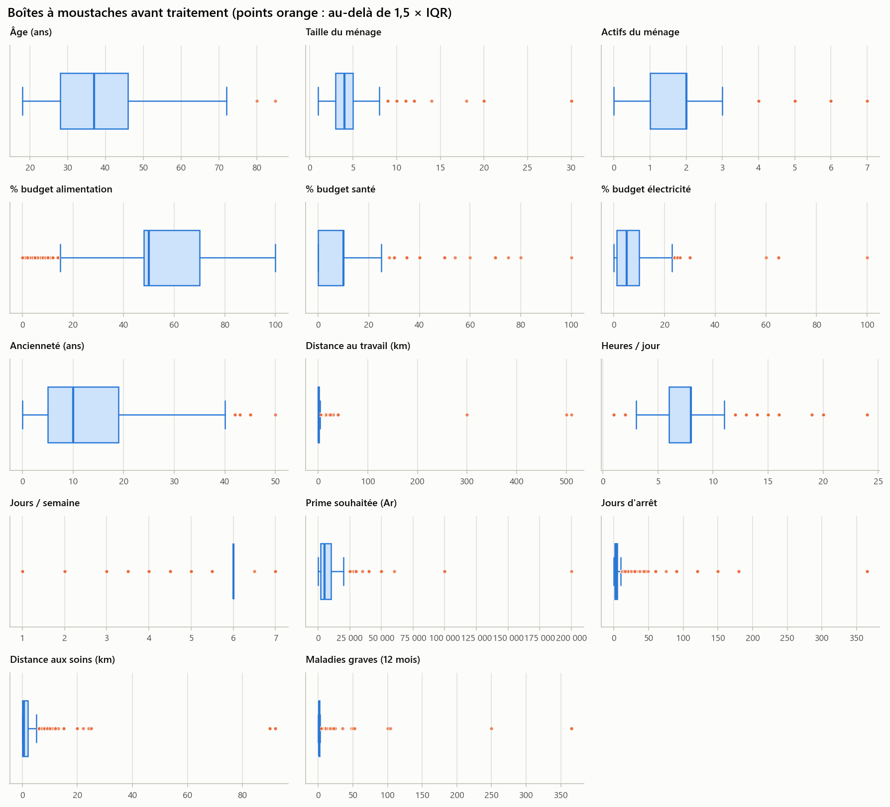
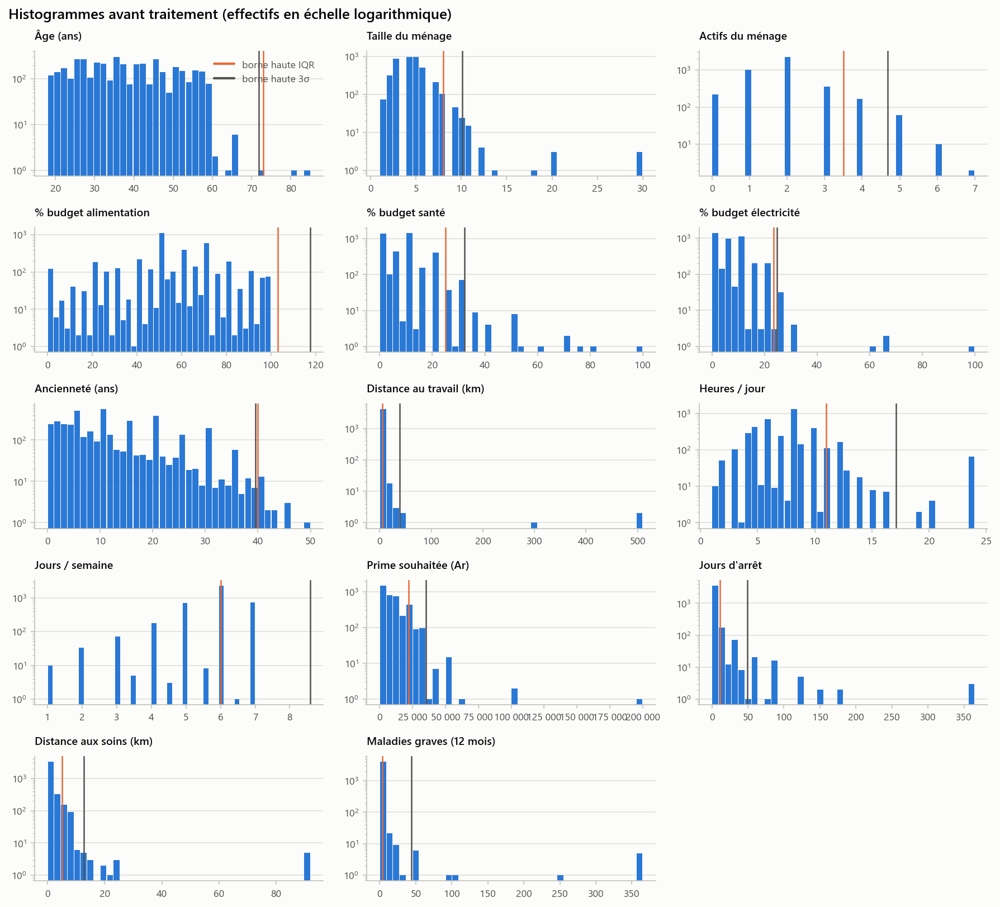
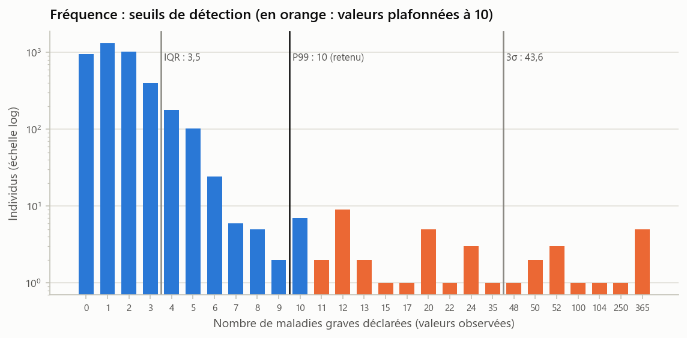
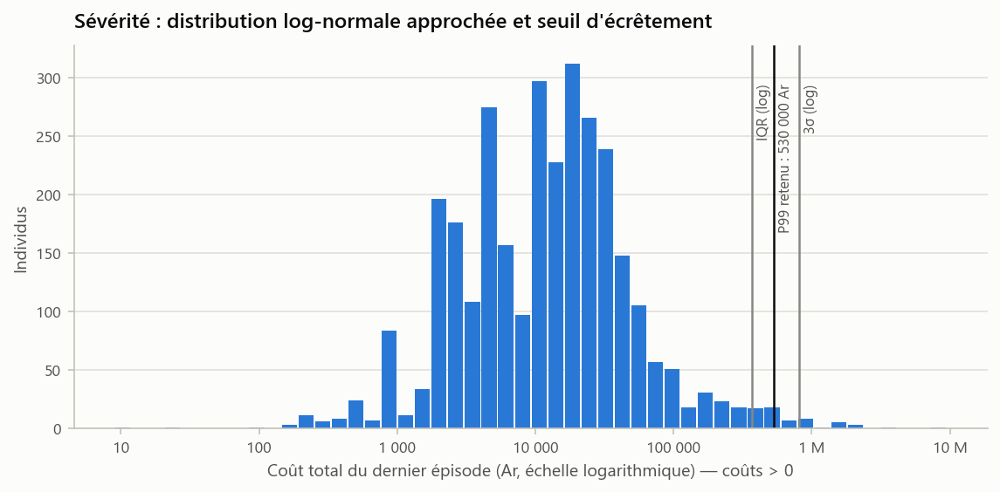
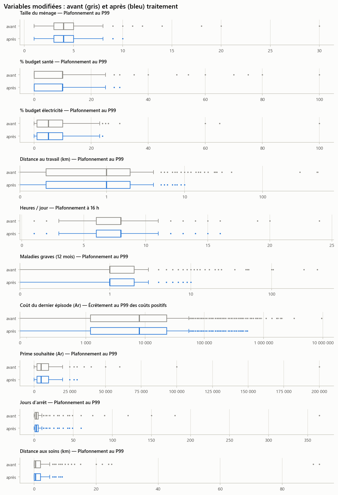

# Étape 1.2 — Détection et traitement des valeurs aberrantes

> **Énoncé (1.2)** : identifier les valeurs aberrantes des variables quantitatives à l'aide de statistiques descriptives et de graphiques (boîtes à moustaches, histogrammes) ; les détecter par la méthode de l'écart interquartile (IQR) ou la règle des trois écarts-types ; proposer une stratégie de traitement (suppression, plafonnement, transformation ou conservation) et la justifier.

## Exécution

```powershell
.venv\Scripts\python.exe partie1_donnees\1.2_aberrantes\etape_1_2_aberrantes.py
```

**Notebook** (déjà exécuté : tableaux et figures visibles sans rien relancer) : [`etape_1_2_aberrantes.ipynb`](etape_1_2_aberrantes.ipynb). **Version LaTeX** de ce document : `README.tex`.

| Entrée | Sortie principale |
|---|---|
| `partie1_donnees/1.1_qualite/resultats/donnees_qualite.csv` | **`resultats/donnees_sans_aberrantes.csv`** (et `.xlsx`) : 4 074 × 61 colonnes, avec les copies brutes `nb_maladies_graves_brut` et `cout_total_brut` |

**Rappel** : les valeurs **impossibles** (âge de 3 ans, ménage de −6 personnes, part de budget de 70 000 %…) ont déjà été mises à manquant à l'étape 1.1. On traite ici les valeurs **possibles mais extrêmes**, qui peuvent être des erreurs de saisie ou de vraies observations rares.

---

## 1. Les deux méthodes de détection

- **IQR (Tukey)** : une valeur est atypique si elle sort de [Q1 − 1,5 × IQR ; Q3 + 1,5 × IQR], avec IQR = Q3 − Q1. La méthode est robuste, car elle repose sur les quartiles, mais elle suppose une distribution à peu près symétrique.
- **Règle des 3 écarts-types** : une valeur est atypique si elle sort de [moyenne − 3σ ; moyenne + 3σ]. Elle suppose une distribution proche de la loi normale, et la moyenne et l'écart-type sont eux-mêmes gonflés par les valeurs extrêmes (*effet de masque*).

| Variable | Q1 | Q3 | Borne haute IQR | Hors IQR | Moyenne | σ | Borne haute 3σ | Hors 3σ | P99 | Max |
|---|--:|--:|--:|--:|--:|--:|--:|--:|--:|--:|
| age | 28 | 46 | 73 | 2 | 37,8 | 11,4 | 71,8 | 3 | 59 | 85 |
| taille_menage | 3 | 5 | 8 | 96 | 4,5 | 1,9 | 10,1 | 27 | 10 | **30** |
| nb_actifs_menage | 1 | 2 | 3,5 | 238 | 1,9 | 0,9 | 4,7 | 73 | 5 | 7 |
| budget_alim (%) | 48 | 70 | 103 | 190 (bas) | 54,0 | 21,2 | 117,6 | 0 | 100 | 100 |
| budget_sante (%) | 0 | 10 | 25 | 101 | 8,0 | 8,1 | 32,1 | 28 | 30 | 100 |
| budget_elec (%) | 1 | 10 | 23,5 | 42 | 6,5 | 6,1 | 24,7 | 40 | 24 | 100 |
| anciennete_emploi (ans) | 5 | 19 | 40 | 8 | 11,9 | 9,2 | 39,5 | 21 | 37 | 50 |
| distance_travail (km) | 0,3 | 2 | 4,6 | 329 | 1,9 | 12,3 | 38,9 | 5 | 10 | **510** |
| heures_jour | 6 | 8 | 11 | 357 | 7,6 | 3,2 | 17,1 | 71 | 24 | 24 |
| jours_semaine | 6 | 6 | 6 | **1 736** | 5,8 | 0,9 | 8,6 | 116 | 7 | 7 |
| **nb_maladies_graves** | 1 | 2 | **3,5** | **363** | 2,25 | 13,8 | **43,6** | **14** | **10** | **365** |
| **cout_total** (Ar) | 1 200 | 23 000 | 55 700 | 298 | 32 514 | 194 165 | 615 009 | 25 | 500 000 | **9 500 000** |
| log10(cout_total > 0) | 3,70 | 4,45 | 5,57 (371 057 Ar) | 80 | 4,08 | 0,61 | 5,91 (815 282 Ar) | 23 | 5,72 | 6,98 |
| prime_souhaitee (Ar) | 2 000 | 10 000 | 22 000 | 212 | 8 359 | 8 891 | 35 031 | 26 | 30 000 | 200 000 |
| jours_arret | 1 | 5 | 11 | 277 | 5,2 | 14,8 | 49,5 | 49 | 60 | 365 |
| distance_soins (km) | 0 | 2 | 5 | 161 | 1,4 | 3,8 | 12,8 | 15 | 9 | 92 |

**Lecture critique** : les deux méthodes donnent des résultats très différents et ne peuvent pas être appliquées aveuglément.

- **L'IQR signale à tort des valeurs normales** quand la distribution est asymétrique ou concentrée. Pour `jours_semaine`, Q1 = Q3 = 6, l'IQR est nul et 43 % des individus seraient « aberrants » simplement parce qu'ils ne travaillent pas 6 jours. Pour le nombre de maladies, l'IQR place la limite à 3,5 et classerait comme aberrants les 9 % d'individus ayant 4 à 10 maladies, alors que ce sont des comptages ordinaires.
- **La règle des 3σ est faussée par les extrêmes eux-mêmes** : pour le nombre de maladies, σ = 13,8 à cause des valeurs à 365, et la limite (43,6) laisse passer des valeurs de 20 à 35 manifestement anormales.
- Pour les **coûts**, très asymétriques, la détection n'a de sens que sur l'échelle logarithmique, où la distribution est proche d'une loi normale (voir figure). Sur cette échelle, les deux méthodes s'accordent : environ 25 à 80 coûts au-delà de 370 000 à 815 000 Ar.





## 2. Variable de fréquence : choix du seuil



La décroissance de 0 à 10 maladies est régulière : ce sont des comptages plausibles. Au-delà de 10, les valeurs (12, 20, 24, 52, 100, 365) correspondent visiblement à un nombre de mois, de semaines ou de jours de maladie, c'est-à-dire aux crises répétées d'une même maladie chronique et non à des sinistres distincts. **On plafonne donc au 99e centile (10)** :

| | Avant | Après |
|---|--:|--:|
| Moyenne | 2,25 | **1,61** |
| Variance | 190,1 | **2,53** |
| Variance / moyenne | 84,5 | **1,58** |
| Maximum | 365 | 10 |
| Valeurs modifiées | — | 39 (0,96 %) |

Le plafonnement ne touche que 1 % des individus mais ramène la variance de 190 à 2,5. Le rapport variance / moyenne de 1,58 reste supérieur à 1, signe d'une **surdispersion modérée** qui sera testée à l'étape 3.1 (Poisson ou binomiale négative). Le choix du seuil a peu d'effet : seules 13 valeurs se situent entre 11 et 13.

## 3. Variable de sévérité : écrêtement



Sur l'échelle logarithmique, le coût suit approximativement une loi log-normale (une légère bimodalité vient des montants ronds : 2 000, 5 000, 10 000, 20 000 Ar). Les plus gros coûts (hospitalisation de 7 M Ar, scanner de 2,4 M Ar, chimiothérapie de 2 M Ar) sont **réels** : les supprimer ferait disparaître le risque que l'assurance doit couvrir. On applique la méthode actuarielle de l'**écrêtement** :

1. le coût est plafonné au **99e centile des coûts positifs : 530 000 Ar** (30 valeurs) pour estimer le GLM de sévérité, qui serait sinon dominé par une poignée de sinistres ;
2. la charge au-delà du seuil n'est pas perdue : elle est **redistribuée sur toutes les primes** à l'étape 3.3 par un coefficient de chargement ;
3. le coût brut reste disponible dans `cout_total_brut`.

| Coûts positifs (3 054 individus) | Avant | Après écrêtement |
|---|--:|--:|
| Moyenne (Ar) | 41 191 | 32 683 |
| Médiane (Ar) | 13 005 | 13 005 |
| Coefficient de variation | 5,29 | **2,28** |
| Maximum (Ar) | 9 500 000 | 530 000 |
| Part de la charge totale au-delà du seuil | — | **20,6 %** |

Le 1 % de sinistres les plus graves représente un cinquième de la charge totale : c'est la signature d'un risque santé à queue épaisse, qui justifie le mécanisme d'écrêtement et de redistribution.

## 4. Stratégie retenue pour chaque variable

| Variable | Rôle | Traitement | Seuil | Valeurs modifiées | Justification |
|---|---|---|--:|--:|---|
| age | explicative | **Conservation** | — | 0 | Après l'étape 1.1, l'âge va de 18 à 85 ans ; les âges de 80 à 85 ans sont réels et rares |
| taille_menage | explicative | **Plafonnement P99** | 10 | 27 | Les grandes familles existent, mais 20 ou 30 personnes relèvent d'un foyer collectif ; le plafond limite leur poids dans les distances du K-means |
| nb_actifs_menage | explicative | **Conservation** | — | 0 | Valeurs de 0 à 7, toutes plausibles |
| budget_alim | explicative | **Conservation** | — | 0 | Bornée à [0 ; 100] % depuis l'étape 1.1 |
| budget_sante | explicative | **Plafonnement P99** | 30 % | 28 | Distribution très asymétrique ; 50 à 100 % pèsent trop dans les distances |
| budget_elec | explicative | **Plafonnement P99** | 24 % | 40 | Même raison |
| anciennete_emploi | explicative | **Conservation** | — | 0 | Déjà limitée par l'âge (≤ âge − 5) à l'étape 1.1 |
| distance_travail | explicative | **Plafonnement P99** | 10 km | 34 | Queue extrême (300 et 510 km) issue de saisies ambiguës |
| heures_jour | explicative | **Plafonnement à 16 h** | 16 h | 71 | « 24 h » ou « 24/24 » décrit un temps de présence, pas un travail effectif ; 16 h est proche de la borne des 3σ (17,1) |
| jours_semaine | explicative | **Conservation** | — | 0 | Bornée à [1 ; 7] ; l'IQR nul n'est pas pertinent |
| **nb_maladies_graves** | cible | **Plafonnement P99** | 10 | 39 | Voir § 2 |
| **cout_total** | cible | **Écrêtement P99** + redistribution | 530 000 Ar | 30 | Voir § 3 |
| prime_souhaitee | descriptive | Plafonnement P99 | 30 000 Ar | 27 | Évite qu'une réponse isolée (200 000 Ar) fausse les moyennes |
| jours_arret | descriptive | Plafonnement P99 | 60 j | 29 | Arrêts de plusieurs mois réels mais rares |
| distance_soins | descriptive | Plafonnement P99 | 9 km | 25 | Soins pris à Antananarivo ou Antsirabe (90 km et plus) |

**Pourquoi plafonner plutôt que supprimer ?** Supprimer une ligne fait perdre les 58 autres informations de l'individu, et supprimer les gros sinistres sous-estimerait le risque. Le plafonnement (winsorisation) garde l'individu, conserve l'ordre des valeurs (un extrême reste au sommet de la distribution) et ne modifie que 0,7 à 1,7 % des valeurs de chaque variable traitée.

**Transformation** : la transformation logarithmique sert à la **détection** pour les coûts. Pour la **modélisation**, la loi de la sévérité (Gamma ou log-normale) est choisie à l'étape 3.2 : le GLM Gamma à lien log tient déjà compte de l'asymétrie.



## 5. Populations pour la modélisation (calculées sur le jeu traité)

| Population | Effectif | Usage |
|---|--:|---|
| Tous les individus | 4 074 | Segmentation K-means, CART |
| Nombre de maladies graves renseigné | 4 046 | GLM de fréquence (étape 3.1) |
| Au moins un sinistre (*N* ≥ 1) | 3 103 | — |
| … dont coût positif | **2 555** | **GLM de sévérité** (étape 3.2) |
| … dont coût nul (remède traditionnel, aucun recours) | 486 (16 % des sinistres renseignés) | Pris en compte dans la prime pure (étape 3.3) |
| … dont coût manquant | 62 | Exclus du GLM de sévérité |

Dans la population de sévérité, le rapport entre la charge brute et la charge écrêtée vaut **1,289** : c'est le coefficient de redistribution de l'écrêtement utilisé à l'étape 3.3.

→ Suite : [étape 1.3 — Préparation pour la modélisation](../1.3_preparation/README.md)

## Fichiers produits

| Fichier | Contenu |
|---|---|
| `resultats/donnees_sans_aberrantes.csv` / `.xlsx` | **Jeu traité** (entrée de l'étape 1.3) |
| `tables/detection_aberrantes.csv` | Statistiques, bornes IQR et 3σ, effectifs hors bornes pour chaque variable |
| `tables/traitement_aberrantes.csv` | Stratégie, seuil, valeurs modifiées et justification |
| `tables/effet_frequence.csv`, `effet_cout.csv` | Effet du traitement sur les deux cibles |
| `figures/boites_avant_traitement.png`, `histogrammes_avant_traitement.png` | Détection graphique |
| `figures/seuils_frequence.png`, `seuils_cout.png` | Choix des seuils pour les cibles |
| `figures/avant_apres_traitement.png` | Variables modifiées, avant et après |
| `resultats/journal.txt` | Sortie complète du script |
