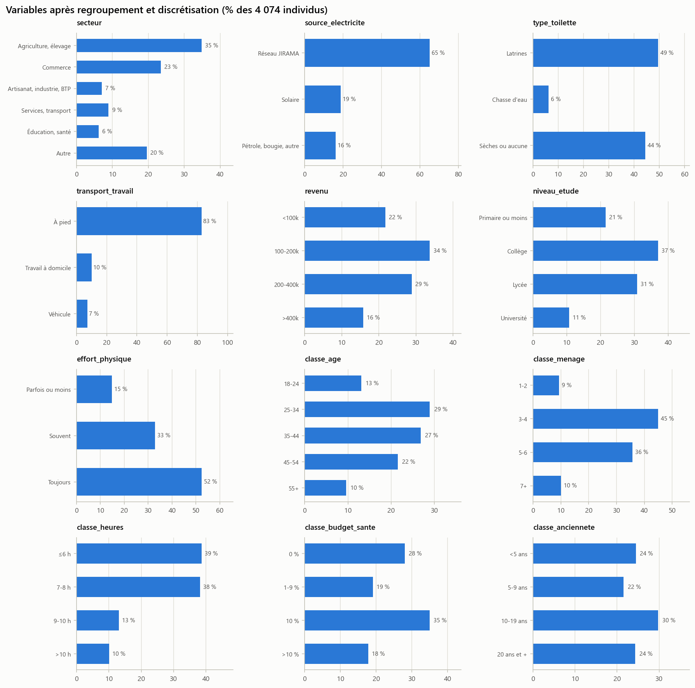
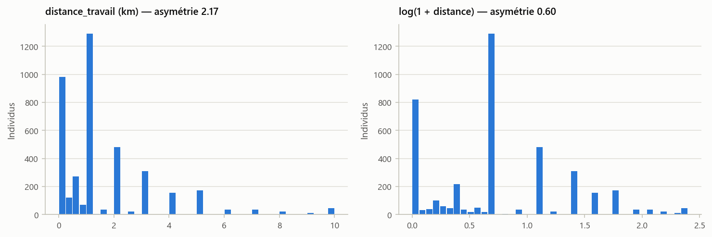

# Étape 1.3 — Préparation des données pour la modélisation

> **Énoncé (1.3)** : encoder les variables qualitatives ; normaliser ou standardiser les variables quantitatives si nécessaire ; évaluer si les variables peuvent être utilisées directement ou si une transformation est nécessaire ; proposer et justifier un regroupement, une discrétisation ou une transformation pour chaque variable concernée ; présenter le jeu de données final.

## Exécution

```powershell
.venv\Scripts\python.exe partie1_donnees\1.3_preparation\etape_1_3_preparation.py
```

**Notebook** (déjà exécuté : tableaux et figures visibles sans rien relancer) : [`etape_1_3_preparation.ipynb`](etape_1_3_preparation.ipynb). **Version LaTeX** de ce document : `README.tex`.

| Entrée | Sorties principales |
|---|---|
| `partie1_donnees/1.2_aberrantes/resultats/donnees_sans_aberrantes.csv` | **`resultats/donnees_finales.csv`** (et `.xlsx`) : 4 074 × 82 colonnes lisibles, pour CART et les GLM |
| | **`resultats/matrice_standardisee.csv`** : 4 074 × 53 colonnes encodées et centrées-réduites, pour le K-means |

---

## 1. Les variables sont-elles utilisables directement ?

Deux critères ont été examinés :

- **Qualitatives : modalités rares.** Une modalité qui regroupe moins de 3 % des individus produit des coefficients instables dans un GLM (estimés sur quelques dizaines de personnes) et des règles fragiles dans un arbre. **11 variables** en ont au moins une : le secteur (18 modalités rares sur 25), le moyen de transport (5), le lien avec le chef de ménage, l'énergie de cuisine, le type de toilette, le statut professionnel, la source d'eau et d'électricité, le niveau d'étude, le revenu et l'effort physique.
- **Quantitatives : asymétrie.** Après le traitement des valeurs aberrantes, seule `distance_travail` reste très asymétrique (asymétrie 2,17). `jours_semaine` (−1,53) est bornée à [1 ; 7] et concentrée sur la valeur 6. Les autres ont une asymétrie inférieure à 1 et peuvent être utilisées telles quelles.

## 2. Regroupement des modalités (variables qualitatives)

Principe : réunir des modalités **proches par le sens** (et non seulement par la fréquence), de façon à ce que chaque groupe soit interprétable et contienne assez d'individus.

| Variable | Groupes obtenus (effectif) | Justification |
|---|---|---|
| secteur | Agriculture, élevage (1 419) · Commerce (955) · Autre (797) · Services, transport (364) · Artisanat, industrie, BTP (287) · Éducation, santé (252) | 25 secteurs → 6 familles d'activité aux contraintes physiques comparables |
| lien_chef_menage | Chef de ménage (2 180) · Conjoint(e) (1 413) · Autre membre (481) | Enfant, parent, frère ou sœur : moins de 10 % chacun |
| statut_pro | Indépendant (3 426) · Salarié (648) | « Salarié et indépendant » (36) a un emploi salarié |
| statut_matrimonial | Marié(e) (2 863) · Célibataire (763) · Veuf(ve), divorcé(e) (448) | Situations de rupture regroupées |
| source_eau | Borne fontaine (3 329) · Puits ou autre (627) · Branchement à domicile (118) | Le branchement (2,9 %) est **gardé seul** malgré le seuil, car c'est le seul marqueur d'accès à l'eau courante |
| source_electricite | Réseau JIRAMA (2 656) · Solaire (764) · Pétrole, bougie, autre (654) | Sans électricité moderne |
| energie_cuisine | Charbon, gaz, électricité (2 789) · Bois (1 285) | Gaz et électricité (8 individus) rejoignent le charbon, combustible acheté en ville |
| type_toilette | Latrines (2 016) · Sèches ou aucune (1 807) · Chasse d'eau (251) | Plein air (22) et autre (3) rejoignent les toilettes sans eau |
| transport_travail | À pied (3 375) · Travail à domicile (408) · Véhicule (291) | Moto, vélo, bus, voiture, taxi : 6 modalités de moins de 2,5 % chacune |
| niveau_etude | Primaire ou moins (875) · Collège · Lycée · Université | Analphabète (97) regroupé avec Primaire |
| revenu | <100k · 100-200k · 200-400k · >400k Ar/mois | 7 tranches → 4, la tranche >1M ne comptant que 51 individus |
| effort_physique | Toujours (2 133) · Souvent (1 338) · Parfois ou moins (603) | Jamais, rarement et parfois : 2 à 9 % chacun |
| interet_couverture | Tout à fait (1 889) · Plutôt oui (1 753) · Non (432) | « Pas du tout » et « plutôt non » réunis |

Pour les variables **ordinales**, le regroupement ne concerne que le libellé utilisé par les GLM. Le **code numérique garde l'échelle complète** (par exemple revenu de 0 à 6), ce qui conserve toute l'information pour le K-means.

## 3. Discrétisation des variables continues

En tarification, les variables continues sont habituellement découpées en **classes**. Cela permet de capter des effets non linéaires (le risque n'augmente pas forcément de la même façon à chaque année d'âge) et d'obtenir un **coefficient lisible par classe** dans les GLM. Les bornes ont été choisies sur des valeurs rondes, de façon à ce que chaque classe regroupe au moins 9 % des individus.

| Classe | Variable source | Classes (effectif) |
|---|---|---|
| classe_age | age | 18-24 (532) · 25-34 (1 180) · 35-44 (1 094) · 45-54 (879) · 55+ (389) |
| classe_menage | taille_menage | 1-2 (383) · 3-4 (1 830) · 5-6 (1 454) · 7+ (407) |
| classe_heures | heures_jour | ≤6 h (1 575) · 7-8 h (1 556) · 9-10 h (534) · >10 h (409) |
| classe_jours | jours_semaine | ≤5 j (1 006) · 6 j (2 339) · 7 j (729) |
| classe_budget_sante | budget_sante | 0 % (1 143) · 1-9 % (778) · 10 % (1 427) · >10 % (726) |
| classe_anciennete | anciennete_emploi | <5 ans (996) · 5-9 ans (876) · 10-19 ans (1 212) · 20 ans et + (990) |
| classe_distance | distance_travail | Domicile (748) · <1 km (694) · 1-2 km (1 813) · >2 km (819) |



## 4. Transformation

| Variable | Asymétrie | Décision |
|---|--:|---|
| distance_travail | 2,17 → **0,60** après log(1 + x) | **Transformation logarithmique** (`log_distance_travail`) pour le K-means : sans elle, les rares longues distances écraseraient les différences entre 0, 1 et 2 km dans la distance euclidienne |
| jours_semaine | −1,53 | Pas de transformation : le logarithme aggrave l'asymétrie (−2,78). La variable est bornée et quasi discrète ; ses classes (≤5 / 6 / 7 jours) la résument mieux |
| 8 autres quantitatives | −0,37 à 0,93 | Utilisées telles quelles |



## 5. Encodage des variables qualitatives

| Type | Encodage | Colonnes | Exemples |
|---|---|--:|---|
| Ordinale | **Code entier** respectant l'ordre des modalités | 10 | niveau_etude_code : Analphabète=0 < Primaire=1 < … < Université=4 ; pb_sante_travail_code : Jamais=0 < … < Régulièrement=3 |
| Binaire | **0 / 1** | 9 | femme, salarie, proprietaire, epargne_oui, dettes_oui, chronique_oui, lunettes_oui, renoncement_oui, cuisine_bois |
| Nominale (3 groupes ou plus) | **Indicatrices** (one-hot), une colonne par groupe | 24 | secteur=Commerce, source_eau=Puits ou autre, transport_travail=Véhicule… |
| Quantitative | valeur (après traitement des aberrantes, log pour la distance) | 10 | age, taille_menage, budget_sante, log_distance_travail… |

Pour les **GLM** (étape 3), on n'utilise pas cette matrice : les variables qualitatives y entrent sous leur libellé regroupé, et le logiciel crée lui-même les indicatrices en prenant comme **référence la modalité la plus fréquente**. On évite ainsi la colinéarité parfaite d'un encodage one-hot complet. Pour **CART** (étape 2.2), les codes ordinaux et les indicatrices sont utilisés directement : les arbres n'ont pas besoin de standardisation.

## 6. Standardisation

Le **K-means** repose sur la distance euclidienne. Sans standardisation, une variable mesurée en grandes unités (budget alimentaire de 0 à 100 %) pèserait des centaines de fois plus qu'une variable binaire (0/1). Chaque colonne de la matrice est donc **centrée-réduite** :

$$z = \frac{x - \bar{x}}{s_x}$$

Après transformation, toutes les colonnes ont une moyenne de 0 (à 2·10⁻¹⁶ près) et un écart-type de 1. Les moyennes et écarts-types utilisés sont enregistrés dans `tables/codage_et_standardisation.csv`, ce qui permet d'appliquer la même transformation à un nouvel assuré.

La standardisation n'est **pas nécessaire** pour CART, qui ne fait que comparer des seuils, ni pour les GLM, dont les coefficients s'ajustent aux unités.

## 7. Jeu de données final

**`donnees_finales.csv`** : 4 074 individus × 82 colonnes :

| Rôle | Colonnes | Utilisation |
|---|--:|---|
| Clé (`id`) | 1 | Suivi des individus, jamais une variable explicative |
| Explicatives : libellés regroupés | 26 | GLM, CART, description des segments |
| Explicatives : codes ordinaux | 10 | K-means, CART |
| Explicatives : quantitatives (et log de la distance) | 11 | K-means, CART |
| Explicatives : classes | 7 | GLM, CART |
| **Cible de fréquence** `nb_maladies_graves` (plafonnée à 10) | 1 | GLM de fréquence |
| **Cible de sévérité** `cout_total` (écrêtée à 530 000 Ar) | 1 | GLM de sévérité |
| Cibles brutes et 6 composantes du coût | 8 | Coefficient d'écrêtement, description |
| Indicateurs de population | 3 | `pop_frequence` (4 046), `pop_severite` (2 555), `sinistre_sans_cout` (486) |
| Descriptives | 14 | Description des coûts, discussion (prime souhaitée, couverture…) |

**`matrice_standardisee.csv`** : 4 074 × 53 colonnes encodées et standardisées (10 codes ordinaux, 9 binaires, 24 indicatrices, 10 quantitatives). L'étape 2.1 y sélectionne les variables de la segmentation.

Le rôle de chaque colonne est donné dans `tables/roles_variables.csv`.

→ Suite : [étape 2.1 — Segmentation K-means](../../partie2_segmentation/2.1_kmeans/README.md)

## Fichiers produits

| Fichier | Contenu |
|---|---|
| `resultats/donnees_finales.csv` / `.xlsx` | **Jeu final** pour CART et les GLM |
| `resultats/matrice_standardisee.csv` | **Matrice encodée et standardisée** pour le K-means |
| `tables/evaluation_variables.csv` | Modalités rares et asymétrie de chaque variable |
| `tables/regroupements.csv` | Correspondance modalités → groupes, avec effectifs |
| `tables/classes.csv` | Classes des variables discrétisées |
| `tables/codage_et_standardisation.csv` | Encodage, moyenne et écart-type de chaque colonne de la matrice |
| `tables/roles_variables.csv` | Rôle de chaque colonne du jeu final |
| `figures/variables_regroupees.png`, `transformation_distance.png` | Figures |
| `resultats/journal.txt` | Sortie complète du script |
